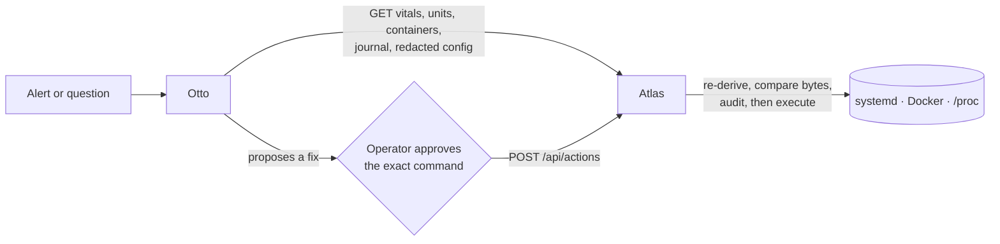

# Atlas

A small, locked-down Go agent that gives a self-hosted server's operator a clear view of the
host, plus a narrow, audited way to act on it.

## Why it exists

My home server runs [Otto](docs/CONTRACT.md#about-the-client), a self-hosted AI command center,
next to the apps I host. I wanted Otto to answer "why is the disk filling up?" and to suggest
"restart that container", without ever giving an AI-driven app a shell or root.

Atlas is the answer: the **only** component with host power. Otto talks to it over HTTP.
Reads are open to any authenticated caller. Every write is an explicitly enabled, allowlisted
action that a human approved, and Atlas rebuilds the command itself instead of trusting the
one it was sent.



## Design

- **One bind address** (`ATLAS_ADDR`): loopback by default, the tailnet in production, never `0.0.0.0`.
- **Token on every `/api` call** (`ATLAS_TOKEN`, checked in constant time). `/healthz` is the only unauthenticated route.
- **Actions off by default.** Each kind is enabled separately, and each has an explicit allowlist; an empty list refuses everything.
- **Never runs the caller's command.** Atlas derives its own argv, compares it byte for byte with what the operator approved, and executes without a shell.
- **Audit before acting.** Every action is appended to a fsynced log before dispatch; request ids are reserved forever.
- **Degrades instead of failing.** A missing permission or tool empties that one source and adds a `warning`; the rest keeps serving.
- **Own systemd unit and own low-privilege user** (`deploy/atlas.service`), isolated from Otto and from the app containers.

Telemetry is gathered with [`gopsutil`](https://github.com/shirou/gopsutil) rather than by
parsing `/proc` by hand; the HTTP layer just serialises the structs in `internal/collect`.

## Run (local dev)

```bash
ATLAS_TOKEN=dev-token go run ./cmd/atlas-agent # local loopback only
curl -s localhost:7788/healthz
curl -s -H 'Authorization: Bearer dev-token' localhost:7788/api/vitals
```

With `ATLAS_DEV=1` and no token, only `/healthz` is usable. Set a token for API reads.

## Run (production)

```bash
go build -o atlas-agent ./cmd/atlas-agent
# ATLAS_TOKEN in an 0600 EnvironmentFile owned by the atlas user; ATLAS_ADDR = tailnet ip
sudo systemctl enable --now atlas
```

Keep the service unprivileged. At deploy time, add its user to the `docker` group so the
read-only collector can access the local Docker socket, and the `systemd-journal` group for journal
reads. Do not run the agent as root. If either grant is absent, the corresponding API
returns an empty list with a `warning` instead of failing the agent.

Processes, network interfaces/ports, and most security data work with those existing grants.
Install `sudo` and `smartmontools`, then add this exact policy with `visudo` so Atlas can read
fail2ban bans and SMART data without running the service as root:

```sudoers
Cmnd_Alias ATLAS_RO = /usr/bin/fail2ban-client status, /usr/bin/fail2ban-client status *, /usr/sbin/smartctl -j -a *, /usr/sbin/smartctl -a *, /usr/sbin/smartctl --scan, /usr/sbin/smartctl --scan-open
atlas ALL=(root) NOPASSWD: ATLAS_RO
```

The executable paths in sudoers must match the host (check with `command -v fail2ban-client` and
`command -v smartctl`), and the username must match the service's `User`. The supplied unit sets
`NoNewPrivileges=false`, which is required for this scoped sudo elevation. Atlas always invokes
these privileged reads with `sudo -n`, so it cannot wait for a password prompt. If sudo, the
policy, fail2ban, or smartmontools is absent, the affected source still returns an empty list and
an explanatory warning while all other collectors continue serving.

Optionally, to let `GET /api/config?id=backup-env` read `/etc/restic/env` (root-only), append this
one exact command to `ATLAS_RO` — no wildcard, no other path:

```sudoers
Cmnd_Alias ATLAS_RO = <existing commands>, /usr/bin/cat /etc/restic/env
```

Without it, that id returns HTTP 503 with an explanatory `error`; unit config reads need no grant.

## Layout

| Path | What |
|---|---|
| `cmd/atlas-agent` | entrypoint: config → HTTP server → graceful shutdown |
| `cmd/maintenance-server` | localhost-only, embedded 503 maintenance black hole |
| `internal/config` | env-driven config + safe defaults (refuses to start without a token) |
| `internal/api` | net/http mux, constant-time bearer auth, audit hook |
| `internal/hostops` | fixed systemd/Docker actions and stable Linux process handles |
| `deploy/actions` | optional privilege templates and operator runbook; controls off |
| `internal/collect` | gopsutil vitals plus read-only systemd, Docker, and journal collectors |
| `deploy/atlas.service` | systemd unit template (placeholders `<ATLAS_USER>` etc.) |
| `deploy/maintenance` | hardened service and fail-safe tunnel/container toggle |
| `docs/CONTRACT.md` | the contract between Atlas and its client |

## Maintenance mode

Maintenance mode combines two independent protections: the app container is stopped, and every tunnel
rule for its origin is pointed at a localhost-only server with no proxy, upstream, redirect, or router.
That black-hole server answers every path and method with `503 Service Unavailable`, an embedded page,
and `Retry-After`. It embeds both the pre-launch `coming-soon` page and the real-downtime `maintenance`
page. `MAINT_PAGE` selects between those exact, case-sensitive names; unset, empty, or invalid values
fall back to `coming-soon`. Install and start `deploy/maintenance/maintenance.service`, then run:

```bash
deploy/maintenance/maintenance-mode.sh on app.example.com <tunnel-name>
deploy/maintenance/maintenance-mode.sh off app.example.com <tunnel-name>
```

Switch the displayed page in one command (the helper writes a systemd drop-in, reloads systemd, and
restarts the maintenance unit without changing tunnel routing):

```bash
deploy/maintenance/set-page.sh coming-soon
deploy/maintenance/set-page.sh maintenance
```

The toggle validates cloudflared configuration before replacing it, rewrites every hostname sharing the
app origin, and keeps maintenance routing active until the restarted container is healthy. Environment
overrides are documented at the top of the script. The app must publish its port on `127.0.0.1` only.
A later `docker compose up -d` can restart a stopped app; its maintenance route remains black-holed, but
run the `on` command again to restore both guarantees.

## Status

Running in production on my home server. Done so far:

- Read-only telemetry: vitals, systemd units, Docker containers, journal, processes, network, security and SMART.
- Bounded per-unit journal tails and redacted config reads, used by Otto's alert investigations.
- Gated, audited host actions (restart a unit or container, SIGTERM a process, apt upgrade, two maintenance tasks). They ship disabled.
- Maintenance mode for hosted apps.

## API

| Route | Auth | Returns |
|---|---|---|
| `GET /healthz` | none | `{"status":"ok"}` |
| `POST /api/actions` | bearer | gated action result `{id, ok, exitCode, output}`; disabled by default |
| `GET /api/vitals` | bearer | host, cpu, memory, disks, net |
| `GET /api/units` | bearer | `units[]`: name, description, active/sub states, since, memory |
| `GET /api/containers` | bearer | `containers[]`: identity/state, CPU, memory, ports, uptime, restart/exit data |
| `GET /api/journal?unit=&priority=&lines=` | bearer | recent `lines[]` `{ts, unit, priority, message}` (default 200, maximum 1000; with `unit`, maximum 300 lines and 64 KiB of messages) |
| `GET /api/config?id=` | bearer | one allowlisted config `{id, path, content, redacted: true}`; ids `unit:<name>` and `backup-env` |
| `GET /api/processes` | bearer | top processes by CPU with user, memory, RSS, uptime, and command |
| `GET /api/network` | bearer | interfaces, listening ports, established connections, and Tailscale peers |
| `GET /api/security` | bearer | 24-hour SSH failures, fail2ban bans, pending updates, and sudo events |
| `GET /api/smart` | bearer | physical-disk SMART health, temperature, wear, hours, and writes |

Collector routes always return HTTP 200 when their host source is missing or inaccessible.
Their list is then empty and the response includes a top-level, operator-facing `warning`.
Invalid journal filters return HTTP 400. All `/api` routes use the same bearer token gate;
these P1 routes are read-only.

`unit` names one exact `.service` or `.timer` (a bare name gets `.service`); journalctl filters
on the host before taking the tail. Each message is capped at 4 KiB, and older lines are dropped
to fit the byte bound; either sets `truncated: true`.

`GET /api/config` is not a file read. `id` must be exactly `backup-env` (fixed path
`/etc/restic/env`, read with `sudo -n /usr/bin/cat`) or `unit:<name>.service|.timer`
(`systemctl cat -- <name>`: the unit file plus drop-ins). Any other id or extra query parameter
is HTTP 400; an unknown unit is 404; an unreadable source is 503. Atlas redacts before
responding and only then sets `redacted: true`: values of keys or flags that look like
passwords, keys, tokens, credentials or account ids (also on commented-out lines and in URL
query parameters), URL userinfo, `Authorization` values, PEM
blocks and long opaque blobs. `backup-env` is fail-closed: only `RESTIC_REPOSITORY` (userinfo,
query string and fragment removed), `RESTIC_CACHE_DIR`, `RESTIC_COMPRESSION`, `RESTIC_PACK_SIZE`, `RESTIC_READ_CONCURRENCY`,
`RESTIC_HOST` and `TMPDIR` keep values; comments and any other line are withheld. Content is
capped at 64 KiB (`truncated: true`). Responses are `Cache-Control: no-store`.

Network bind scope is conservative: loopback is `local`, Tailscale IPv4/IPv6 ranges are `tailnet`,
and every other bind (including LAN and wildcard addresses) is `public`. Tailscale `lastSeen` is
epoch milliseconds or `null`; `route` is `direct`, `relay:<region>`, or empty. Security hourly
buckets run oldest to newest. SMART state is `fail` for a failed health result and `warn` for
reallocated sectors, at least 80% wear, or temperature at least 60°C. All four routes are read-only.


## Host actions

`POST /api/actions` implements the [client contract](docs/CONTRACT.md). All API routes
require the literal `Bearer ` prefix. The body contains exactly `id` (`ha_<uuid>`),
`kind`, `target`, and the exact canonical `command` shown by Otto. Atlas derives its
own command, compares it byte for byte, and executes without a shell. The command
received from Otto is never executed. For example:

```json
{"id":"ha_00000000-0000-0000-0000-000000000001","kind":"restart-unit","target":{"unit":"demo.service"},"command":"systemctl restart demo.service"}
```

| Variable | Default / meaning |
|---|---|
| `ATLAS_ACTIONS` | empty (off); comma list: `restart-unit,restart-container,kill-process,apt-upgrade,run-maintenance` |
| `ATLAS_RESTART_UNITS` | empty; exact `.service` names, aliases refused |
| `ATLAS_RESTART_CONTAINERS` | empty; exact names, only running/restarting containers |
| `ATLAS_KILL_USERS` | empty; explicit non-root usernames; SIGTERM only |
| `ATLAS_APT_UNIT` | `atlas-apt-upgrade.service`; fixed, reviewed root oneshot |
| `ATLAS_ACTION_DIR` | `./atlas-actions`; durable ids and unresolved-action interlock |
| `ATLAS_AUDIT` | `./atlas-audit.log`; append-only JSON lines, fsynced before dispatch |

Kinds with empty allowlists refuse all targets. Apt is restricted to the reviewed
unit's two fixed commands rather than a target list. `run-maintenance` takes
`{"task":"backup-unlock"}` or `{"task":"backup-cache-dir"}` only, mapped by Atlas to
`otto-maint-backup-unlock.service` / `otto-maint-backup-cache-dir.service` (command
`systemctl start <unit>`). Atlas refuses (422, nothing executed) unless that exact unit is
installed and loaded, is not an alias, and is a oneshot; it returns 409 if the unit is already
active. The start blocks until the oneshot exits and reports that invocation's result. Actions require a non-empty
token even with `ATLAS_DEV=1`. Protected units are Otto, Atlas, Tailscale, the apt
unit, and Atlas's actual cgroup unit; container `atlas` is protected. Process stops
validate user, command, and start time within five seconds using the telemetry
identity logic, then signal a Linux pidfd. Root, kernel, Atlas ancestry, and processes
inside protected unit cgroups are refused. Platforms without pidfds fail closed.

| HTTP status | Meaning |
|---|---|
| 404 | actions off |
| 401 | missing/invalid Bearer token |
| 400 | malformed request |
| 409 | reused id, command/identity mismatch, busy or unresolved action |
| 422 | policy, identity, storage, audit or privilege preflight refusal; nothing executed |
| 200 | completed operation; inspect boolean `ok`, integer/null `exitCode`, UTF-8 output tail (≤4000 bytes) |
| 5xx | unknown outcome; inspect host and audit before requesting another action |

Valid ids are reserved forever, including when policy refuses their first request.
One action runs at a time, with a durable interlock surviving agent restarts.
`action.received` and `action.executing` must be durable before dispatch;
`action.completed` records the result. Completion-audit failure is logged and keeps
the interlock even though the response reports the known result. Unknown outcomes
and crashes also retain it for manual reconciliation. The same directory must be
used by every agent instance; never delete it to retry a request.

Action connections allow 31 minutes, while ordinary routes retain their existing
HTTP timeouts. Host work uses independent contexts, so disconnecting does not cancel
it. Budgets are 85 seconds for restarts, 10 seconds for SIGTERM, and 29 minutes for
apt. apt runs outside Atlas's filesystem sandbox and survives an agent restart.
A failed upgrade may have changed packages; successful SIGTERM does not guarantee
process exit.

The [operator runbook](deploy/actions/README.md) covers narrow polkit privileges,
optional CAP_KILL, enabling controls, manual end-to-end verification, unknown-result
recovery and rollback. No host installation or privilege change is automatic.

Repository checks: `go build ./...`, `go vet ./...`, `go test ./...`. Tests use fake
host operations; three HTTP tests bind an ephemeral loopback socket. They do not
run systemd, Docker mutations, apt, process signals, or a shared-database suite.

## License

[MIT](LICENSE)
